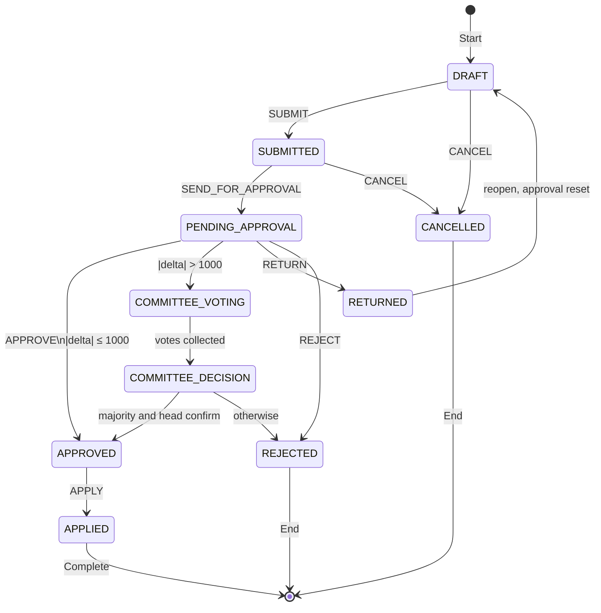

# Implementation Notes

> Fill this in as part of your submission. Aim for 1–2 pages of honest engineering notes — bullet points
> are fine. This document is read alongside your code and is a meaningful part of the evaluation. Delete
> these instructions before submitting.

## 1. What I changed
<!-- A short summary of the changes you made, ideally grouped by task. What bugs did you fix, what did you
implement, and why? -->

I worked through the tasks in order and committed as I went. The scaffold already had submit, the totals helper, and the audit helper. Most of my work is in `cr-service.ts`, plus the two bug fixes and the read scoping.

**Task 1 — the two failing tests (`bugs fixed.`)**

`round2` was using `Math.trunc`, so a value like 10.005 became 10.00 instead of 10.01. I switched it to `Math.round` so money rounds to the nearest cent.

`assertTransition` only blocked terminal states. A draft could jump straight to approved. I added the `canTransition` check so anything that is not in the legal table throws `ILLEGAL_TRANSITION`.

**Task 2 — approval flow**

I filled in the missing rows on the transition table: pending approval, committee voting, committee decision, approved, and returned.

Then I wired the actions that were still throwing "not implemented":

- `sendForApproval` moves a submitted request to pending approval. If the absolute delta is over 1000 it also opens committee voting.
- `approve` and `reject` are for the small path only. A committee request cannot be approved or rejected from here.
- `returnToDraft` only works from pending approval. It goes returned, then back to draft, and clears approvals and any committee votes so the request starts clean.
- `apply` only runs from approved. If the delta is positive and the budget balance is too small, it throws insufficient budget and does not touch the budget. Otherwise it books the delta and reduces the balance, using `round2` so the cents stay consistent.
- I also added `cancel`, since the state machine already allowed draft and submitted to go to cancelled.

Every status change goes through the existing `transition` helper, so the audit row is written with the action.

**Task 3 — committee (`Task 3 — Committee routing`)**

`castVote` only accepts a vote while the request is in committee voting, and only from a member on that committee. A member cannot vote twice. Each vote is appended to the audit.

It resolves when a majority has approved and the committee head has also approved: voting, then committee decision, then approved. If everyone has voted and that rule is not met, it goes to rejected instead. I also refuse to start a large request when the committee has no members or no head.

**Task 4 — permissions (`permissions and test case added`)**

`findOne` was returning a change request by id with no org check. I send it through `scoped`, same as list, so another org gets nothing back and the service treats it as not found.

Each action now checks a policy before it does anything: update (`cr_u_*`) for submit and send for approval, approve (`cr_a_*`) for approve, reject, return, and cancel, and apply (`cr_x_*`) for apply. `list` uses `crReadScope`. Org scope sees the org, workspace scope is limited to the user's workspaces, user scope is limited to requests they created. No read policy means they cannot list.

**Task 5 — tests**

I added tests around the flows I actually built, using the seed data:

- small path: submit, approve, apply, and the budget moving
- return: only from pending approval, then back to draft with progress cleared, and the illegal jumps
- committee: a large delta opens a vote, and it approves when the head and the other member both accept
- cancel, including that a cancelled request cannot move again
- money edges: delta of exactly 1000 stays with one approver, one cent over opens the committee, short budget does not change the balance, exact balance applies and ends at zero
- permissions and org isolation: wrong policy is forbidden, a user only sees their read scope, and org A cannot touch org B's request

## 2. Domain model
<!-- Describe the domain in your own words: the entities, the state machine, and how transitions are
guarded. A small diagram or table is welcome. -->

-This service manages purchase agreements between an organization and its vendors. When an agreement needs a change, such as a date extension or a quantity change, the agreement is not updated directly. The change goes through a change request and several transition phases. A small change (delta) follows a shorter approval flow: one approver can approve it. A larger change (delta) follows a longer flow, with a committee vote and confirmation by the committee head. A request can be approved, returned, rejected, or cancelled. If it is returned, approval progress is reset and the same flow runs again: DRAFT, SUBMITTED, and PENDING_APPROVAL. After approval it can be applied. APPLIED, REJECTED, and CANCELLED do not move again; those statuses are locked. Permissions restrict which actions a user may take, and a user in one organization cannot read or change another organization's change requests. Every status change adds a row with who, what, and when, and that row is not edited later.

## 3. Invariants I enforce (and how)

| Invariant | How it's enforced | Where (file / function) |
|---|---|---|
| A request can only move along the legal path | The allowed next statuses live in one table. Every status change calls `assertTransition` before the status is written. If the pair is not in the table, it throws `ILLEGAL_TRANSITION`. | `cr-state-machine.ts` (`LEGAL_TRANSITIONS`, `assertTransition`); called from `CrService.transition` |
| Applied, rejected, and cancelled never move again | `isTerminal` runs first. Those three statuses throw `TERMINAL_STATE` before the table is even checked. | `cr.enums.ts` (`TERMINAL_STATUSES`); `assertTransition` |
| Money is kept to 2 decimal places | Line totals, sums, and the delta all go through `round2`, which uses `Math.round` (nearest cent, not truncate). | `money.util.ts` (`round2`, `lineTotal`, `sumMoney`); `cr-totals.ts` (`computeTotals`) |
| A positive delta cannot overspend the budget | Apply recomputes totals, then refuses if `delta > 0` and `balance < delta`. The throw happens before the status or the budget is changed. A negative delta adds the money back. | `cr-service.ts` (`apply`) |
| A large change cannot be approved by one person | If `\|delta\|` is over 1000, send-for-approval opens committee voting. `approve` throws if the delta is still over the threshold, or if the request is already in a committee status. | `cr-service.ts` (`sendForApproval`, `approve`); threshold is `COMMITTEE_DELTA_THRESHOLD` in `cr.types.ts` |
| Committee result needs a majority and the head | Only listed members can vote, and only once, and only while status is `COMMITTEE_VOTING`. It becomes approved when approve-votes are more than half the members and the head voted approve. If everyone has voted and that is not true, it is rejected. | `cr-service.ts` (`castVote`) |
| A return clears the approval and starts again from draft | Return is allowed only from `PENDING_APPROVAL`. It records returned, then draft, then wipes `approvals` and any committee votes. | `cr-service.ts` (`returnToDraft`) |
| Apply only happens after approval | Apply checks the status is `APPROVED` before it looks at the budget. Anything else throws and the budget stays as it was. | `cr-service.ts` (`apply`) |
| One org cannot see or change another org's request | List and single read both go through `scoped`, which keeps only rows whose `orgCode` matches the caller. A miss looks like not found. | `cr-repo.ts` (`scoped`, `list`, `findOne`); `CrService.getOrThrow` |
| Read scope limits what you can list | No `cr_r_*` policy means list is forbidden. Org sees the org, workspace sees the user's workspaces, user sees only requests they created. | `policy.ts` (`crReadScope`); `cr-service.ts` (`list`) |
| Each action needs the matching policy | Submit and send-for-approval need `cr_u_*`. Approve, reject, return, and cancel need `cr_a_*`. Apply needs `cr_x_*`. The check is the first thing in the method. | `cr-service.ts` (each action); `policy.ts` (`hasPolicy`) |
| Every status change is written to the audit and not edited | `transition` appends a new audit row (action, user, time) and never updates an old one. A cast vote appends its own row the same way. | `cr-service.ts` (`transition`, `castVote`) |

## 4. Testing strategy

I kept the two tests that came with the scaffold and added my own around the flows I built. Everything runs on the in-memory seed (`buildSeed`), so there is no database and the cases stay deterministic. I cared more about the rules that can go wrong (wrong status, wrong money, wrong org) than about hitting every method once.

What I did test:

- Money rounds to the nearest cent, and a draft cannot jump straight to approved. A terminal status cannot move.
- The small path: submit, send for approval, one approver, apply, and the budget booked and balance actually change. A decrease of 500 stays with one approver, and apply puts that 500 back (booked 7500, balance 10500). The seed cases do the same positive path against BUD-1 and BUD-9.
- Return only from pending approval, then back to draft with the old approval cleared. Sending a draft straight to pending, returning a draft or a submitted request, and returning something already approved or applied all throw.
- A large delta opens committee voting. It is approved only when Carl and the head (Dina) both accept. It is rejected when Dina votes no, and also when Carl votes no and Dina votes yes, because one approve out of two is not a majority. A second vote from Carl is refused and the first vote stays. The budget does not move on a rejection.
- Cancel from draft, then nothing else is allowed. Cancel is also refused from returned, applied, and committee decision.
- The threshold edges: delta of exactly 1000 stays with one approver, 1000.01 opens the committee. A short budget throws and leaves the balance alone. A balance that matches the delta applies and ends at zero. An empty committee throws before the status moves.
- Org isolation: Mona cannot read or act on Bob's request, and Bob cannot touch org-alpha. The other budget is unchanged.

Permissions, and what I left out:

I did not test every permission. The code accepts user, workspace, or org scope on each action (`cr_u_u` / `cr_u_w` / `cr_u_o`, and the same for approve and apply). I only checked the people already in the seed, because that is who the flows use:

- Alice can update and read her own requests. She cannot approve, reject, return, cancel, or apply.
- Mona can approve, apply, and cancel inside the org.
- Carl can approve and vote. He cannot submit, send for approval, or apply.
- A user with no read policy cannot list. Alice's list is only her own. Carl's org read sees the org, not org-beta. A workspace reader pointed at the wrong workspace gets an empty list.
- Someone who is not on the committee cannot cast a vote.

I did not add a case for each scope on each action. Workspace scope is only checked on list, and only as a miss.

## 5. Assumptions

A few places in the brief can be read more than one way. This is what I decided.

**Exactly 1000 stays with one approver.** The committee opens only when the absolute delta is greater than 1000. A delta of 1000 is still a normal approval. The brief says "at or below" for one approver and "exceeds" for the committee, so the equal case stays on the short path.

**A large change does not sit in pending approval.** `sendForApproval` writes pending approval and, when the delta is over 1000, committee voting in the same call. The totals are already known, so there is no extra person who has to press a second button to route it. The audit still has both steps. The downside is that return only works from pending approval, so once a large request has been sent it cannot be returned. It has to be voted or it stays in voting.

**Return goes all the way back to draft in one call.** The diagram shows returned, then draft. I do both inside `returnToDraft`, with two audit rows, and I clear approvals and any committee votes. The person returning it wants it editable again. I did not leave it parked on returned for a second action.

**The head confirms by voting approve.** There is no separate confirm action. The request is approved when more than half the members have voted approve and the head's vote is approve. Half the members, not half of the votes so far, so a 2-person committee needs both. If every member has voted and that rule is not met, I reject it then. I did not want it to sit in voting with no votes left to cast.

**A negative delta gives the money back.** The brief only says a positive delta must fit in the balance. On apply, any non-zero delta updates booked and balance. A decrease lowers booked and raises balance. A zero delta applies and leaves the budget alone. If the balance is short, I throw before the status or the numbers change.

**Action scope is the policy string, not "this is your request".** Submit and send-for-approval need any update policy (`cr_u_u`, `cr_u_w`, or `cr_u_o`). Approve, reject, return, and cancel need any approve policy. Apply needs any apply policy. I did not also check that a `_u` policy only touches requests that user created, or that a `_w` policy only touches their workspace. Read scope is applied on list. Loading one request by id only checks the org. I treated the policy as "may do this action in the org" and left the finer scope for list, which is where the brief talks about what a user can see.

**Cancel uses the approve policy.** Killing a request is closer to reject than to editing a draft, so I gated it with `cr_a_*`. The state machine still only allows cancel from draft and submitted.

**A committee request cannot be approved or rejected by one person.** Even with an approve policy, `approve` and `reject` throw while it is in committee voting or committee decision. The votes are the only way out.

## 6. Where I used AI

I used Cursor while I was building this. I did not paste in a finished service. I wrote the transitions, the actions, and the tests myself, and I used the chat when I was stuck or when I wanted a second look.

What I used it for:

- Explaining the brief in plain words, like what "commit incrementally" means and what the invariants table is asking for.
- Talking through a function before I typed it. Reject and apply are the ones I went back and forth on. I asked for a sketch, then told it not to edit the file, and I put the version I understood into `cr-service.ts`.
- Checking my own code. I asked whether `reject` really goes through the legal-transition and terminal checks, why `apply` should use `recomputeTotals` instead of looking the agreement up again.
- A failing committee test. The audit rows did not match what I expected. I asked why, got a short explanation of `CAST_VOTE` versus `RESOLVE_COMMITTEE`, and fixed the recording myself.
- These notes. Sections 1, 3, 4, 5, and this one were drafted from my commits and the code, in my words. Section 2 I wrote myself after reading the seed, the enums, and the brief.

How I checked it: if a suggestion did not match the brief or the test I already had, I did not take it. The committee audit is the clear example. I ran the tests after the changes. I can walk through any of these functions without the chat.

## 7. What I'd improve with more time

The riskiest part is permissions on a single request. List honors user, workspace, and org scope. `get` only checks the org. So if Alice knows the id, she can open Mona's request even though her list hides it. The action checks have the same hole. Holding `cr_u_u` or `cr_a_w` is treated as "you may do this anywhere in the org". I would apply the same scope on get and on each action, and add tests where the policy is real but the request is not theirs.

Next to that, a large request cannot be returned. `sendForApproval` jumps it from pending approval to committee voting in one call, and return only works from pending approval. I would let a committee request come back to draft, and I would clear the votes when it does.

