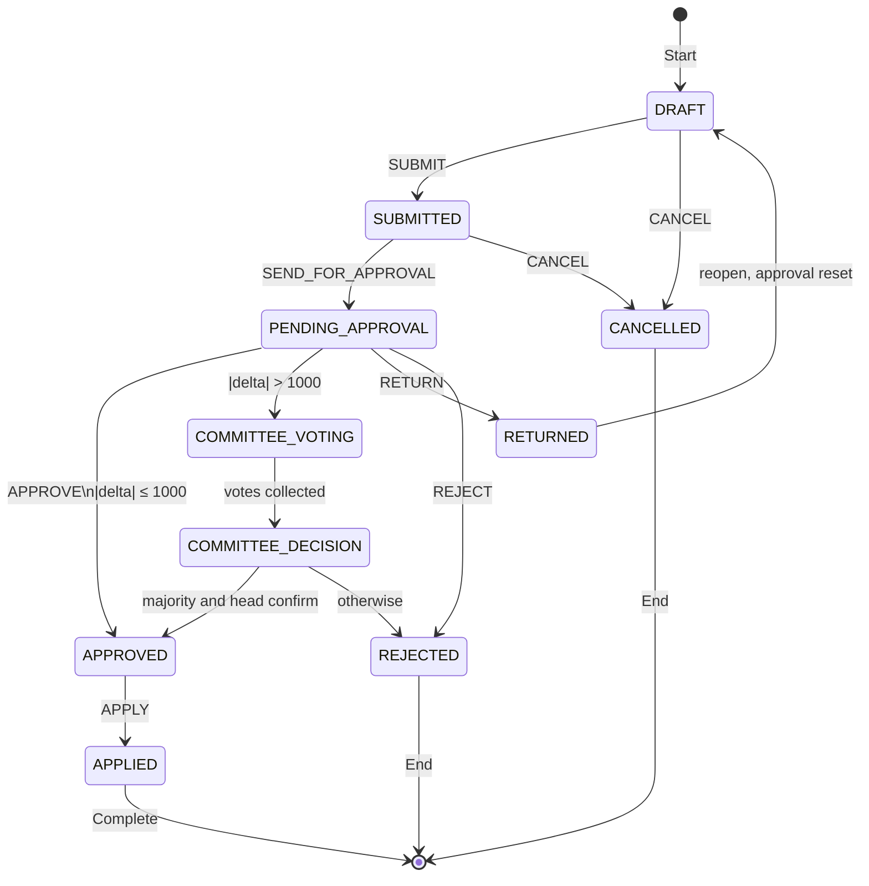

# Implementation Notes

> Fill this in as part of your submission. Aim for 1–2 pages of honest engineering notes — bullet points
> are fine. This document is read alongside your code and is a meaningful part of the evaluation. Delete
> these instructions before submitting.

## 1. What I changed
<!-- A short summary of the changes you made, ideally grouped by task. What bugs did you fix, what did you
implement, and why? -->

-

## 2. Domain model
<!-- Describe the domain in your own words: the entities, the state machine, and how transitions are
guarded. A small diagram or table is welcome. -->

-This service manages purchase agreements between an organization and its vendors. When an agreement needs a change, such as a date extension or a quantity change, the agreement is not updated directly. The change goes through a change request and several transition phases. A small change (delta) follows a shorter approval flow: one approver can approve it. A larger change (delta) follows a longer flow, with a committee vote and confirmation by the committee head. A request can be approved, returned, rejected, or cancelled. If it is returned, approval progress is reset and the same flow runs again: DRAFT, SUBMITTED, and PENDING_APPROVAL. After approval it can be applied. APPLIED, REJECTED, and CANCELLED do not move again; those statuses are locked. Permissions restrict which actions a user may take, and a user in one organization cannot read or change another organization's change requests. Every status change adds a row with who, what, and when, and that row is not edited later.

## 3. Invariants I enforce (and how)
<!-- Which properties your implementation guarantees, and where in the code each one is enforced. -->

| Invariant | How it's enforced | Where (file / function) |
|---|---|---|
|  |  |  |

## 4. Testing strategy
<!-- What did you test and why? What did you deliberately NOT test, and why was that a reasonable cut
given the time budget? -->

-

## 5. Assumptions
<!-- The rules leave some things open to interpretation. Where you had to make a judgment call, state the
decision you made and the reasoning behind it. -->

-

## 6. Where I used AI
<!-- Allowed and expected. Briefly: what you used it for, and how you verified the output. No transcripts
needed. -->

-

## 7. What I'd improve with more time
<!-- The riskiest part of your solution, known limitations, and what you'd do next. -->

-
